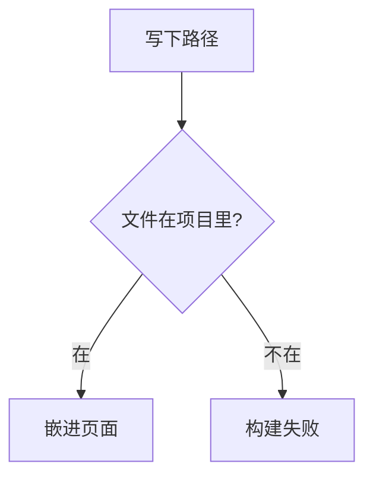

# 讲解图

一张图只回答一个问题。图前用一句话说它在回答什么。图后只写图上没有的规则，例如残差是子层输出和输入相加，再做层归一化。公式留在正文，写法见 [note-markup](../note-markup/SKILL.md) 的 `references/theme.md`。

## 选媒介

- 步骤、判断、时序、节点不多的状态用 mermaid。源码留在 Markdown 里。
- 架构、左右对照、数据怎么流、靠位置和颜色才能看懂的图用 Excalidraw。源文件放在文章旁边。
- 照片、截图、已有位图用 `:::image-figure`。

## Mermaid

围栏语言写 `mermaid`。页面会按亮色或暗色重画。

````md

````

判断用菱形 `{}`，箭头上的字写在 `|文字|`，节点文字放进 `[]`。时序用 `sequenceDiagram`，参与者写中文简称。完整例子在 `src/content/shorts/diagram.md`。

## Excalidraw

围栏里只有一行相对路径。

````md
```excalidraw
./figures/transformer.excalidraw
```
````

文件放在当前 Markdown 旁边的 `figures/`，扩展名 `.excalidraw`。路径相对这篇 Markdown，并且必须留在项目目录内。构建时读不到文件会失败。不要把 JSON 贴进 Markdown。

读者打开时整张图会缩进视口。右下角可以缩放、还原和全屏。拖动可以平移；按住 ⌘ 或 Ctrl 再滚动可以缩放。字号和间距按第一次打开就能读完来排。图上不留一块依赖页面标题的说明。

背景写在文件的 `appState.viewBackgroundColor`。讲解图用 `transparent`，亮色页面是白底，暗色页面是浅灰底。只有这张图自己需要一块纸色时才写颜色。合法值是 `transparent`、`#rgb`、`#rrggbb`、`#rrggbbaa`，以及 `rgb()`、`rgba()`、`hsl()`、`hsla()`。别的字符串会按透明处理。

元素怎么写、颜色怎么沿用，见 [excalidraw.md](references/excalidraw.md)。结构图样板是 `src/content/shorts/figures/transformer.excalidraw`。
